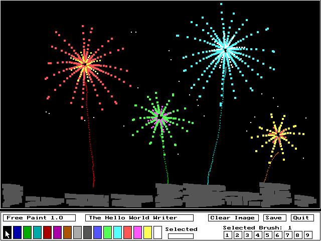

# Freepnt


Free Paint 1.0 is a small mouse-driven paint program I wrote in October 1995 in Borland Turbo Pascal 7, while I was learning two things at once: how to use the mouse, and how to leave the 80x25 text mode of DOS for graphics. Turbo Pascal's `Graph` unit, the Borland Graphics Interface (BGI), switches the screen to 640x480 VGA with 16 colors and lets you draw on it pixel by pixel, and the mouse driver tells you where the pointer is and which buttons are down. Put the two together in a loop and you have a paint program.

<p align="center">
  
</p>

The development snapshots I kept show the whole program written in one sitting on October 20, 1995. At 02:48 I was reading Borland's sample code for the graphics mode. At 03:57 I had a first test that put one green pixel wherever the mouse was while a button was held. By half past six it had the control bar with its color strip, by a quarter past nine it could save a picture, by eleven it was the editor it still is, and at 11:51 I wrote the viewer.

Thirty-one years later, in October 2026, I brought it back to life in DOSBox Staging on Windows. It still works, saved pictures included.

## What it does

`FREEPNT <file>` opens a picture, or starts a new one, in the editor. Paint by holding down a mouse button over the picture, and use the control bar below it for everything else:

| Control | What it does |
|---|---|
| **Color strip** | Selects one of the 16 VGA colors to paint with |
| **Brush buttons 1-9** | Selects the brush size, from a single pixel up to a 9x9 square |
| **Clear Image** | Fills the whole picture with the selected color |
| **Save** | Saves the picture to its file |
| **Quit** / **Q** | Quits, asking to save first if the picture has changed |

`FREEPNTV <file>` shows a saved picture until you press **Q**. Both programs print a short help screen when run without a file name, and add the `.FE1` extension when you leave it out.

### Dabs, not lines

Free Paint doesn't draw lines. Each time it reads the mouse, it stamps a square of the brush size where the pointer is, with nothing in between. A slow stroke overlaps its squares into a solid line, and a fast one leaves them apart as a trail of separate dabs. That is the program's character, and the sample picture of fireworks is made of exactly such flicks.

### Things to know

- Starting the editor on a new file creates that file right away. Quit without saving, and it stays behind empty, and both programs then refuse to open it with "Error reading picture file". Delete it to use the name again.
- The brush grows up and left from the tip of the pointer, and the single-pixel brush paints one pixel up and left of it.

### The .FE1 format

A Free Paint picture is the 632x410 picture area saved as raw BGI `GetImage` data, with no header of its own: nine horizontal strips, eight of 51 lines and a last one of 5 lines that overlaps the eighth by 3. Each strip holds its width and height, then each line as four bit planes, so every file is exactly 130,562 bytes.

## Run it in your browser

<p>
  <a href="https://thehelloworldwriter.github.io/Freepnt/">
    
  </a>
</p>

The browser version runs the same DOS programs in [js-dos](https://js-dos.com/), a DOSBox port for the web, and opens the editor on the fireworks so you can paint over them right away. Pictures you save stay in your browser. After you quit, type `FREEPNT FIREWORK` at the DOS prompt to paint again, or `FREEPNTV FIREWORK` to view the picture.

Chrome and Edge can also install it as an app, and Safari can add it to the Dock or the Home Screen. It then opens in its own window, but still needs an internet connection.

## Download

<p>
  <a href="https://github.com/TheHelloWorldWriter/Freepnt/releases/latest">
    
  </a>
</p>

The ZIP contains the editor and the viewer, Borland's `EGAVGA.BGI` graphics driver that they load at startup, the fireworks picture, a short readme, and the MIT license. Unzip it into one folder and run `FREEPNT FIREWORK` from there in [DOSBox Staging](https://www.dosbox-staging.org/) or any DOS-compatible environment with a mouse driver.

## Building and running

I build and run Freepnt using [DOSBox Staging](https://www.dosbox-staging.org/) on Windows, with a copy of [Borland Turbo Pascal 7.0](https://winworldpc.com/product/turbo-pascal/7x) downloaded from WinWorld:

1. Mount the project directory and the Turbo Pascal installation in DOSBox Staging
2. Copy `EGAVGA.BGI` from Turbo Pascal's `BGI` directory into the directory you start the IDE from, since both programs load it from the current directory
3. Launch `TURBO.EXE` and set **Options > Directories** to point at the `UNITS\` path
4. Open `SRC\FREEPNT.PAS` or `SRC\FREEPNTV.PAS`
5. Press **Alt+F9** to compile, **Ctrl+F9** to run

To build from the command line instead, run `python scripts/build.py`. It compiles both programs in DOSBox Staging without opening the IDE, and checks that each result is byte-identical to the EXE in the v1.0.0 release. Set `DOSBOX` to the DOSBox Staging executable and `DOS_C_DIR` to the folder that DOSBox mounts as `C:`, with Turbo Pascal installed in it. The script looks for the compiler at `C:\BP\BIN\TPC.EXE` and for the graphics driver at `C:\BP\BGI\EGAVGA.BGI`; set `TPC` and `BGI` if yours are elsewhere, for example `C:\TP\BIN\TPC.EXE`. With `--web`, it also rebuilds the browser version in `web/`, and with `--package`, it writes the release ZIP to `dist/`.

## Source layout

```
SRC/
  FREEPNT.PAS           the editor
  FREEPNTV.PAS          the viewer
  FPTOOLS.PAS           screen layout, brushes and the picture file, shared by both
UNITS/
  MOUSE.PAS             mouse driver calls through INT 33h
  FILLIB.PAS            file name and file existence helpers
  STDSTR.PAS            string routines
  INTEG.PAS             integer and hexadecimal routines
  STDCHAR.PAS           character types and digit/hex constants
  CRTKEYB.PAS           keyboard input with extended-key handling
dist/
  FIREWORK.FE1          the sample picture, for the browser version and the ZIP
  README.TXT            readme for the ZIP
  LICENSE.TXT           license for the ZIP
web/
  index.html            browser version, running the DOS programs in js-dos
  freepnt.jsdos         js-dos bundle with both EXEs, the driver and the sample, written by build.py
  manifest.webmanifest  web app manifest, for installing it as an app
  icons/                favicon and app icons
scripts/
  build.py              build, browser bundle and release ZIP
```

The six units are small and reusable on their own. `STDCHAR.PAS` and `CRTKEYB.PAS` are the same files as in [Toggtime](https://github.com/TheHelloWorldWriter/Toggtime), and they may eventually move into a shared Hello World Writer Pascal library.

## License

Freepnt is licensed under the [MIT License](LICENSE).

---

Made with ❤️ in Oradea, Romania
[https://www.thehelloworldwriter.com](https://www.thehelloworldwriter.com)
